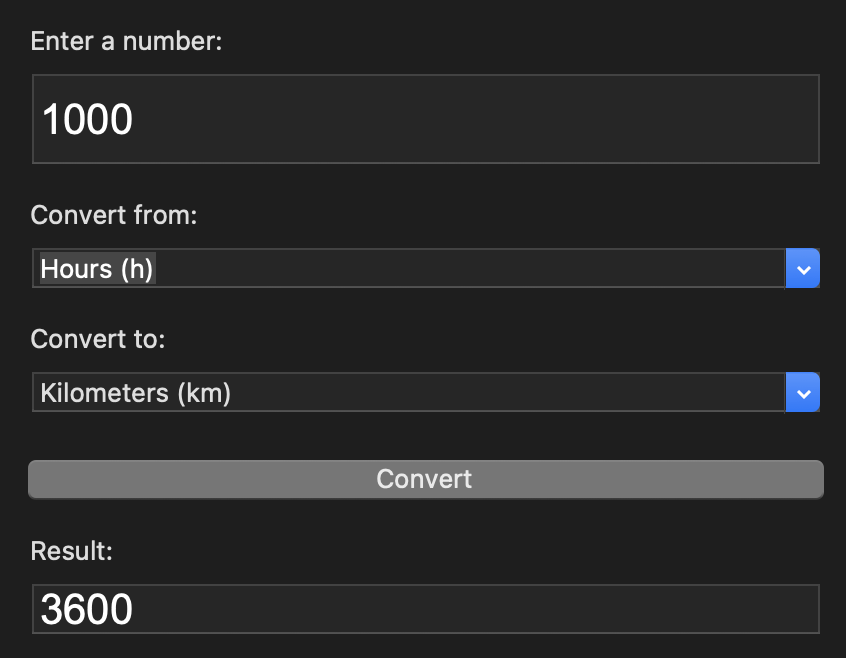
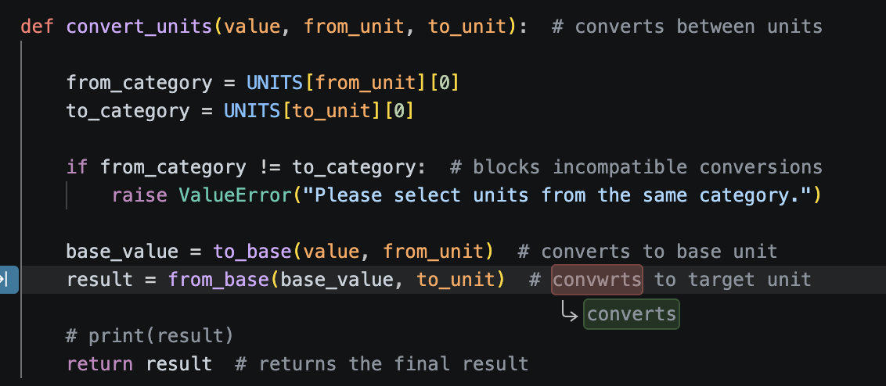
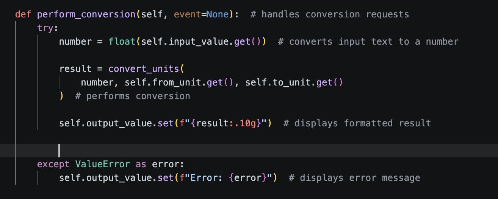

# Hayun's Ultimte Unit Converter

**Level:** 2D  ·  **Language:** Python

## Pitch
- **The problem:** Converting measurements from one unit to another manually can be slow and tedious.
- **The user:** Anyone who needs to convert measurements quickly and accurately.
- **What it does:** This program is a unit converter built entirely in Python and used Tkinter for its gui. Users enter a number, select a starting unit and a target unit, and receive the converted result.
- **Done looks like:** The program successfully converts supported units, displays accurate results, and the user can properly interact with the gui.

## Plan

### Pseudocode
**run_this.py**
- imports tkinter for gui stuff and creates the main application window
- Starts the tkinter loop
  
**gui.py**
- sets the application window dimensions and layout
- a textbox for number input
- drop down menus for selecting units
- a "convert" button that runs the coversion
- an output box for displaying the result

**converter.py**
- store units and conversion factors
- organize the units by what they measure (distance, temperature, etc)
- convert the value that's in the starting unit the user put in into the base unit of its category (temperature, distance, etc) and then convert into the target unit
- return the converted result

## Debugger Walkthrough
- Had to add a separate temperature specific conversion section inside the conversion functions because the general equation doesn't work for temperature
- had an issue with python 3.9.6 interpreter that my mac had by default so i had to install python 3.15 for the tkinter display to work properly (it was previously displaying a grey window with none of the bottons visible)
- Had an issue where the converter was allowing the user to improperly convert a value in a unit of a one category to a unit in a different category, resulting in a coversion that makes no sense. (SHOWN IN THE SCREENSHOT)  So, I made it so the conversions only worked between units of the same category by adding the following if statement into the unit coverting function (SEE SCREENSHOT)  Also, added a try except into gui.py so the error message is displayed in the gui and the user can see what they did wrong 

## How to Run
Run "run_this.py" to start the program

## Changes Along the Way
*What changed from your plan, and why.*

## AI Collaboration
| # | What I asked | What came back | What I kept / changed |
|---|---|---|---|
| 1 | Asked it to create a dictionary with different units and the conversion factors based on the base unit of that category (length, mass, temperature, volume, time) | a dictionary called "UNITS" containing exactly what i asked | kept the entire dictionary with the units and conversion factors |
| 2 | Asked it to make the textboxes bigger because the way i had made them were way too small and hard to read | ipady = 8, width = 25, geometry = (440x400) | kept the changes as it looked a lot better |